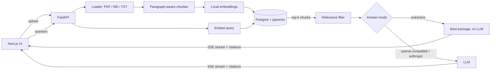

# DocuMind

**Ask questions about your own documents and get answers with page-level citations.**

DocuMind is a retrieval-augmented generation (RAG) app: a Python/FastAPI backend with pgvector
search and a Next.js chat interface. Upload PDFs, Markdown, or text files, then ask questions in
natural language. Answers stream back live, grounded in your documents, with numbered citations
that point to the exact file and page. If the answer isn't in your documents, it says so instead
of guessing.

## Features

- **Grounded answers with citations**: click a citation chip to see the exact source passage
- **Abstains when it should**: low-similarity retrievals never reach the LLM, so unanswerable questions get an honest "I couldn't find that"
- **Streaming responses** over Server-Sent Events (sources first, then tokens), with a Stop button
- **Runs completely free**: local embeddings plus a no-LLM mode. Plug in a free LLM tier or a local model when you want written answers (see below)
- **Provider-agnostic generation**: any OpenAI-compatible endpoint (Groq, Gemini, OpenRouter, Ollama, ...) or Claude
- **pgvector + HNSW** for fast cosine-similarity search in plain Postgres
- **Eval harness** measuring retrieval hit-rate, answer correctness, and abstention
- **Tested in CI** (pytest, ruff, TypeScript type-check, production build) and fully containerised

## Architecture



## Quick start (100% free, no API keys)

Requires Docker and Node 20+.

```bash
git clone https://github.com/<you>/documind && cd documind
cp .env.example .env              # defaults to free "extractive" mode
docker compose up --build         # API on http://localhost:8000 (docs at /docs)
```

In a second terminal:

```bash
cd web
cp .env.example .env.local
npm install
npm run dev                       # UI on http://localhost:3000
```

Open http://localhost:3000, click **Try with a sample document**, and ask a question. The first
upload downloads a small embedding model (~100 MB) once.

## Answer modes

| Mode | Cost | What you get |
|---|---|---|
| `extractive` (default) | Free, offline | Best-matching passage plus ranked sources, with citations. No LLM involved. |
| `openai_compatible` | Free tiers or local | Written, cited answers from any OpenAI-style endpoint |
| `anthropic` | Paid | Written, cited answers from Claude |

To get written answers for free, uncomment one block in `.env` (all blocks are in `.env.example`):

- **Groq**, **Google Gemini**, **OpenRouter** (`:free` models): sign up for a free API key, no credit card
- **Ollama**: run a model locally, completely offline (`ollama pull llama3.2`)

Free-tier limits and model names change often, so check each provider's page. Embeddings are always
local, so only the final answer step ever needs a key.

## API

| Method | Path | Description |
|---|---|---|
| `POST` | `/documents` | Upload a `.pdf`, `.md`, or `.txt` file (max 10 MB) |
| `GET` | `/documents` | List documents with chunk counts |
| `DELETE` | `/documents/{id}` | Delete a document and its chunks |
| `POST` | `/ask` | Ask a question; returns an SSE stream of `sources`, `token`, `done` events |
| `GET` | `/health` | Liveness check and active answer mode |

```bash
curl -F "file=@evals/corpus/acme_handbook.md" http://localhost:8000/documents
curl -N -X POST http://localhost:8000/ask -H "Content-Type: application/json" \
  -d '{"question": "How many days of annual leave do employees get?"}'
```

## Evaluation

RAG systems fail quietly, so DocuMind ships with an eval harness:

```bash
python -m evals.run_evals            # retrieval + answer checks
python -m evals.run_evals --no-llm   # retrieval only (always free)
```

It reports **hit@k** (was the right source retrieved?), **keyword match** (does the answer contain
the expected fact?), and **abstention** (does it decline unanswerable questions?). Add cases to
`evals/dataset.jsonl` and documents to `evals/corpus/`.

_Results on the sample corpus:_ `hit@5: _/_` · `keyword: _/_` · `abstain: _/_` _(fill in after your first run)_

## Deploying for free

- **Database:** a free Postgres with the `pgvector` extension (for example Neon) works. Set `DATABASE_URL`.
- **Frontend:** Vercel's free hobby tier. Set `NEXT_PUBLIC_API_URL` to your API's URL.
- **API:** any host that runs a Docker container. Free tiers are small, and the embedding model needs
  a few hundred MB of RAM. Add your frontend URL to `CORS_ORIGINS`.

## Design decisions and trade-offs

- **Chunking:** paragraph-aware packing (≤1000 chars, 150 overlap) per page, so every chunk has an
  exact page number. Fixed-size windows were simpler but split sentences and made citations less precise.
- **Local embeddings:** a small ONNX model keeps the project free to run and removes a vendor
  dependency. Trade-off: slightly lower retrieval quality than the largest hosted models.
- **Relevance threshold:** chunks under `MIN_SCORE` are dropped before generation, the main defence
  against hallucinated answers to out-of-scope questions.
- **Extractive fallback:** the app is fully usable and testable without any LLM, and retrieval
  quality can be judged on its own before generation enters the picture.
- **pgvector over a dedicated vector DB:** one datastore for documents, chunks, and vectors keeps ops
  simple at this scale.
- **Sync endpoints:** FastAPI runs them in a threadpool, fine for CPU-bound embedding. Heavy
  ingestion would move to a background worker.

## Roadmap

- [x] Web UI with streaming answers and clickable citations
- [ ] Hybrid search (BM25 + vectors) with a reranker
- [ ] Background ingestion queue and OCR for scanned PDFs
- [ ] Per-user auth and document isolation
- [ ] Conversation memory and query rewriting

## Project layout

```
app/               FastAPI service
  main.py          routes + SSE streaming
  rag.py           prompts, relevance filter, answer modes
  store.py         pgvector queries
  db.py            schema + connection pool
  embeddings.py    local embedding model
  ingest/          file loaders and chunking
web/               Next.js (App Router, TypeScript) chat UI
evals/             labelled dataset, sample corpus, eval runner
tests/             pytest suite
```

## License

MIT
